# 🎓 DHIYONI Tutorials - Comprehensive EdTech & Tutoring Platform

[](https://www.dhiyonitutorials.com)
[](https://www.dhiyonitutorials.com/admin/login)
[](https://react.dev/)
[](https://www.mongodb.com/)
[](#)

> **DHIYONI Tutorials** is an end-to-end, full-stack educational web application and administrative management portal. It connects K-12 and competitive exam students across CBSE, ICSE, and State Boards with elite 1-on-1 private educators, while offering administrators a real-time lead CRM, faculty management suite, dynamic media gallery, and communication dispatcher.

---

## 📌 Quick Links & Live Demos

| Resource                  | Link                                                                                         | Description                                |
| :------------------------ | :------------------------------------------------------------------------------------------- | :----------------------------------------- |
| 🌐 **Production Website** | [https://www.dhiyonitutorials.com](https://www.dhiyonitutorials.com)                         | Main student & parent portal               |
| 🔐 **Admin Portal**       | [https://www.dhiyonitutorials.com/admin/login](https://www.dhiyonitutorials.com/admin/login) | Administrative authentication & CRM        |
| 📂 **GitHub Repository**  | [sriparthu1422/Dhiyoni-Tutorials](https://github.com/sriparthu1422/Dhiyoni-Tutorials)        | Source code repository                     |
| 💬 **Instant Counseling** | [WhatsApp Counseling Chat](https://wa.me/917901034846)                                       | Live pre-filled academic counselor inquiry |

---

<!--## 🔑 Demo & Admin Credentials

 To inspect and test the back-office administration capabilities, utilize the pre-configured administrative credentials:

- **Admin Login URL:** [https://www.dhiyonitutorials.com/admin/login](https://www.dhiyonitutorials.com/admin/login)
- **Admin Email:** `admin@dhiyoni.com`
- **Admin Password:** `DhiyoniAdmin2026!`
- **Role:** `admin` (Full CRUD permissions across leads, tutors, gallery, newsletters, and security settings)

--- -->

## 🏗️ Architecture & Technology Stack

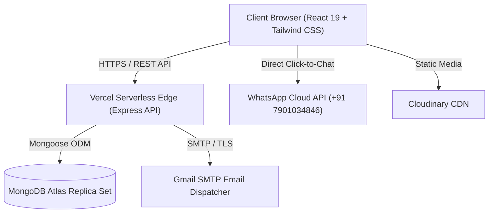

### 💻 Frontend Architecture

- **Framework:** React 19.2 (Functional Components & Hooks) + Vite 8.0
- **Routing:** React Router DOM v6 (Client-side routing with route guards & scroll-to-top automation)
- **Styling:** Tailwind CSS v3.4 with custom design tokens (Montserrat & Inter typography, glassmorphism, responsive elevation shadows)
- **Icons & Visuals:** Material Symbols Outlined, custom SVGs, Cloudinary optimized imagery
- **SEO & Social Sharing:** `react-helmet-async` dynamic OpenGraph meta tags, Twitter cards, and Schema.org JSON-LD structured data

### ⚙️ Backend Architecture

- **Runtime:** Node.js v24+ with Express 4.21 configured for Vercel Serverless Functions
- **Database:** MongoDB Atlas (Mongoose ODM with connection pooling & DNS IPv4 resolution)
- **Security:** Helmet HTTP headers, CORS origin controls, JWT (`jsonwebtoken`) Bearer authentication, and BcryptJS salted password hashing
- **Communications:** Nodemailer SMTP email automation notifying management upon new parent and tutor registrations
- **Logging:** Morgan HTTP request logger

---

## 📋 Comprehensive Page-by-Page Project Audit

Below is a detailed breakdown of each public and administrative module in the application, accompanied by high-resolution visual evidence.

---

### 1. 🏠 Home Page (`/`)

- **Live URL:** [dhiyonitutorials.com](https://www.dhiyonitutorials.com/)
- **Target Audience:** Prospective parents, students looking for specialized home/online tuition, and potential tutors.
- **Key Modules:**
  - **Hero Value Proposition:** High-impact heading _"Empowering Minds, Shaping Futures"_, verified 4.6/5 rating badge, and prominent action buttons for Parent Sign-Up and Tutor Sign-Up.
  - **Why Choose DHIYONI:** Pillars highlighting top 1% vetted educators, individualized pacing, and interactive whiteboard tools.
  - **Curriculum Overview:** Grade 3–5 foundational skills, Grade 6–12 board mastery, and IIT-JEE/NEET foundation courses.
  - **Dynamic Gallery Strip:** Live gallery showcase fetched directly from MongoDB.
  - **Verified Testimonials:** Real feedback from students and parents.
  - **Exit-Intent Modal:** Detects mouse departure from window and triggers a conversion-focused counseling prompt.

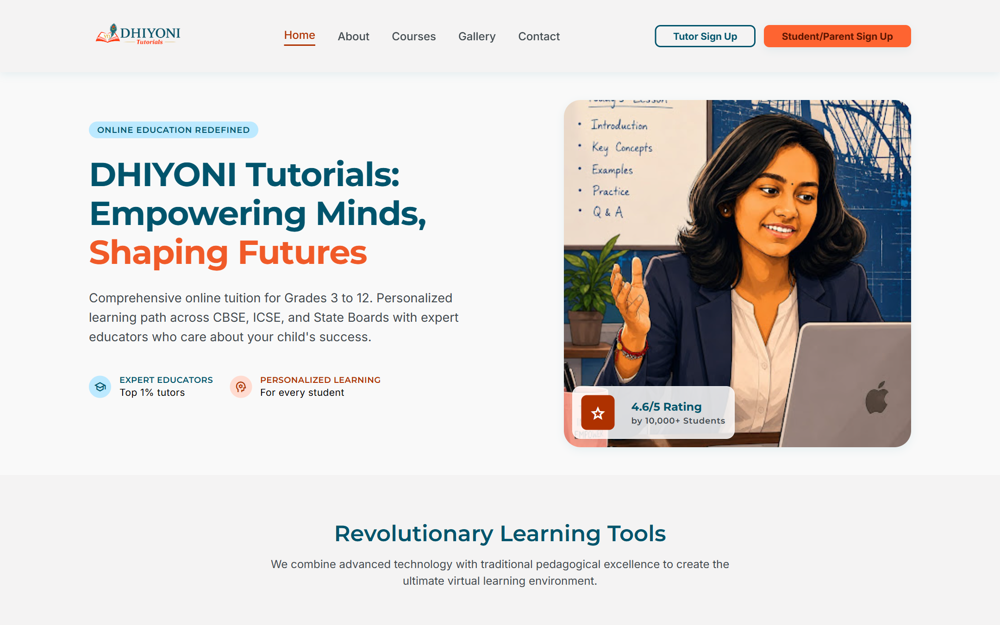
_Figure 1: Home page hero section with value propositions, trust badges, and quick enrollment triggers._

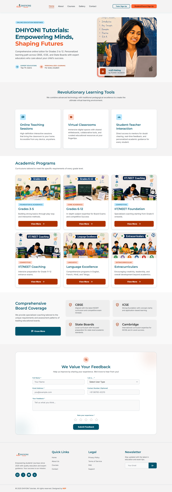
_Figure 2: Complete Home page flow showcasing curriculum highlights, why-choose pillars, live gallery, and testimonials._

---

### 2. 📖 About Us (`/about`)

- **Live URL:** [dhiyonitutorials.com/about](https://www.dhiyonitutorials.com/about)
- **Target Audience:** Parents evaluating institutional credibility and pedagogical philosophy.
- **Key Modules:**
  - **Our Journey:** Chronicling the foundation in Hyderabad, expanding across CBSE, ICSE, and State curricula with a 98% academic success rate.
  - **Our Mission & Vision:** Democratizing personalized mentorship and supplementary tutoring.
  - **Academic Heritage:** "15+ Years Academic Excellence" accreditation showcase.
  - **Consultation Call to Action:** Direct WhatsApp counseling trigger.

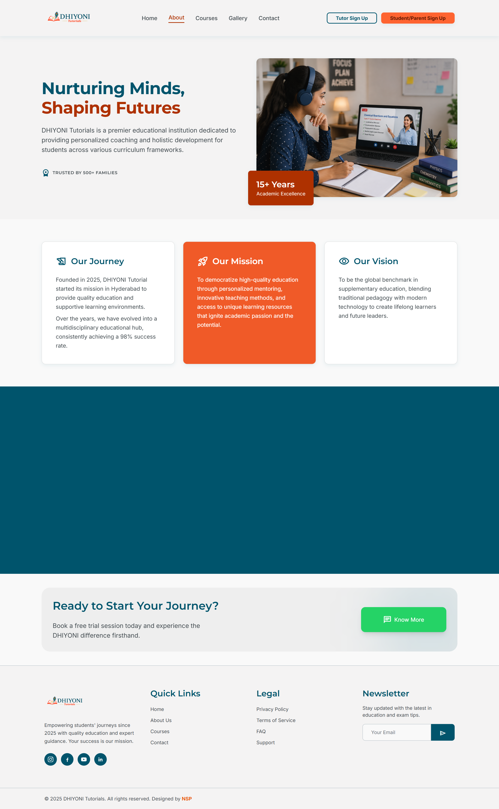
_Figure 3: About Us page illustrating core values, organizational milestones, and pedagogy._

---

### 3. 📚 Courses & Programs Directory (`/courses`)

- **Live URL:** [dhiyonitutorials.com/courses](https://www.dhiyonitutorials.com/courses)
- **Target Audience:** Parents exploring subject-specific syllabi and competitive examination packages.
- **Key Modules:**
  - **Categorized Tabs:**
    1. **Grade 3–5 (Primary):** Core conceptual understanding in Math, Science, and English.
    2. **Grade 6–10 (Secondary):** Rigorous board exam preparation (CBSE, ICSE, State Boards).
    3. **IIT / NEET Foundation:** Early analytical problem solving for Grades 8–10.
    4. **IIT / NEET Advanced Coaching:** Specialized physics, chemistry, mathematics, and biology coaching for Grades 11–12.
    5. **Language & Skill Development:** Spoken English, Hindi, Vedic Math, and beginner Coding.
  - **Program Highlights Card:** Interactive breakdown of revision sessions, personalized attention, and homework assistance.

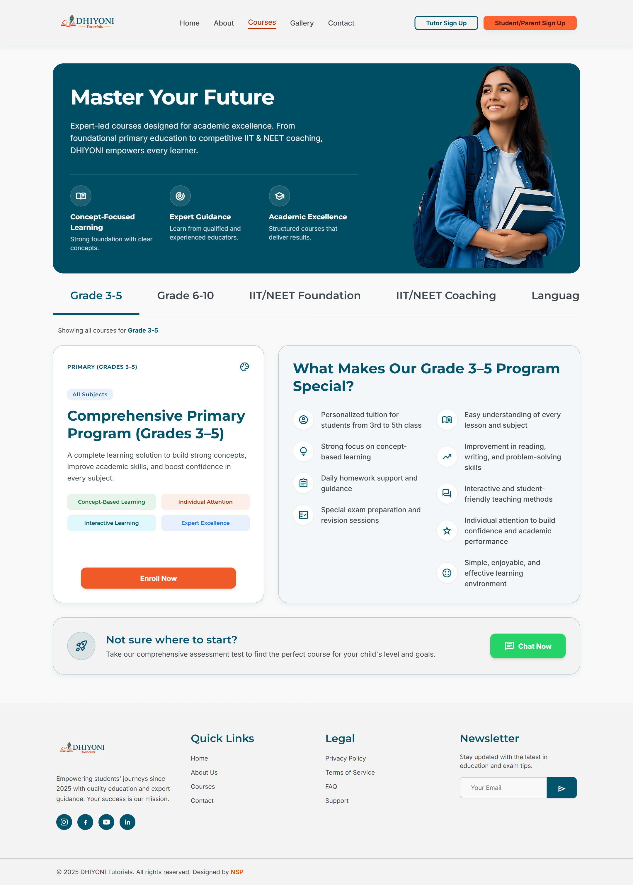
_Figure 4: Dynamic Courses page displaying comprehensive multi-tier academic curricula._

---

### 4. 👨‍🏫 Faculty & Tutors Directory (`/tutors`)

- **Live URL:** [dhiyonitutorials.com/tutors](https://www.dhiyonitutorials.com/tutors)
- **Target Audience:** Parents seeking to review educator credentials, subject specializations, and verified ratings.
- **Key Modules:**
  - **Live Backend Integration:** Fetches tutor profiles dynamically via `/api/tutors`.
  - **Educator Cards:** Displays educator photo, qualification (M.Sc, Ph.D, B.Ed, NET), years of experience, rating, and supported boards.
  - **Filter Controls:** Filter by subject (Mathematics, Physics, Chemistry, Biology) and Board (CBSE, ICSE, State Board).


_Figure 5: Faculty directory displaying verified tutor profiles with credentials and qualifications._

---

### 5. 🖼️ Dynamic Photo Gallery (`/gallery`)

- **Live URL:** [dhiyonitutorials.com/gallery](https://www.dhiyonitutorials.com/gallery)
- **Target Audience:** Prospective students and parents seeking a glimpse of classroom sessions and student achievements.
- **Key Modules:**
  - **Database Sourced:** Dynamically rendered from MongoDB via `/api/gallery`.
  - **Category Tagging:** Workshop sessions, student celebrations, tutoring milestones.
  - **Responsive Lightbox:** High-resolution image preview cards with fallback error handling.

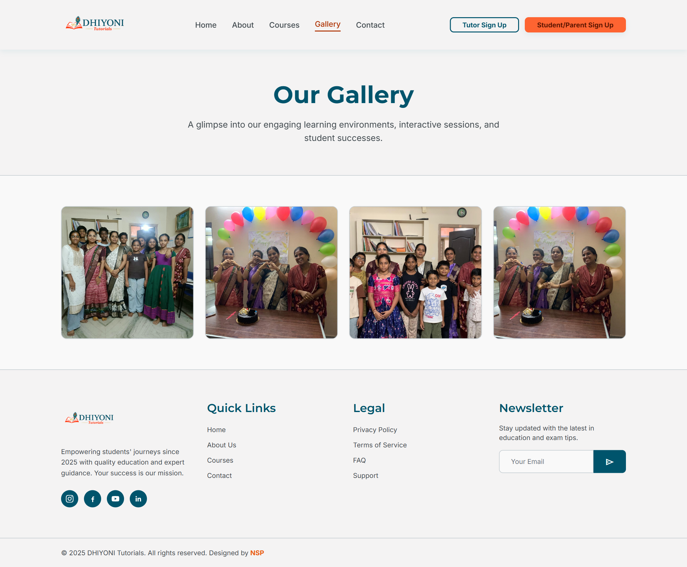
_Figure 6: Community photo gallery celebrating student milestones and classroom engagements._

---

### 6. 📞 Contact & Admissions Office (`/contact`)

- **Live URL:** [dhiyonitutorials.com/contact](https://www.dhiyonitutorials.com/contact)
- **Target Audience:** Families seeking direct assistance, offline consultation, or location details.
- **Key Modules:**
  - **Dual-Channel Submission:** Submits contact form data to MongoDB (`/api/contacts`) and automatically builds a pre-formatted WhatsApp chat dispatch.
  - **Admissions Details:**
    - **Address:** Flat no: 204, 3rd floor, Sigma Sarovar, Bandam kommu, Ameenpur Road, 502032, Hyderabad, India.
    - **Phone:** +91 79010 34846
    - **Email:** `dhiyonitutorials@gmail.com`
  - **Satellite Location Map:** Embedded geolocation map for walk-in parent counseling.
  - **Common FAQ Accordion:** Instant answers to common questions about tutor selection, homework help, and scheduling.

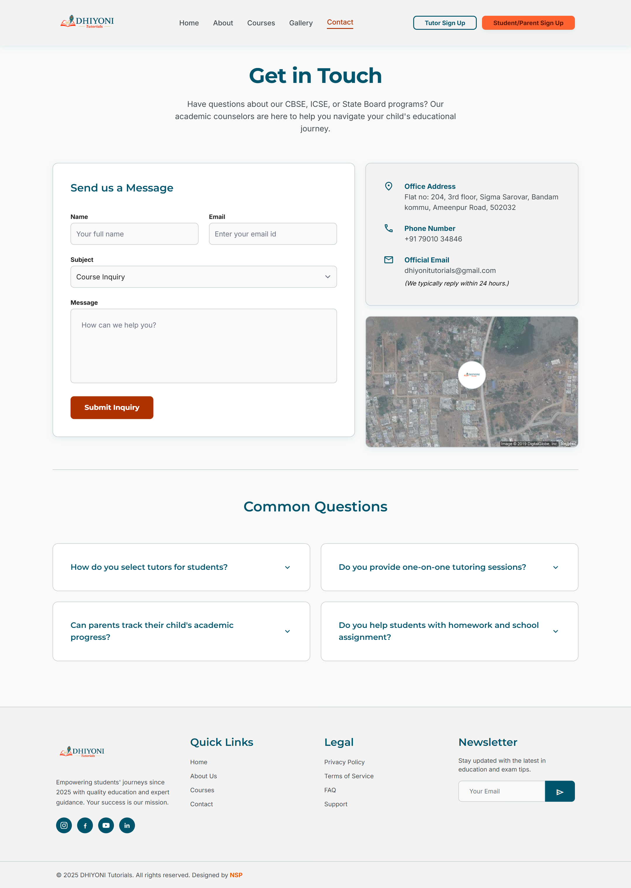
_Figure 7: Contact page with inquiry submission, satellite office mapping, and quick FAQ accordions._

---

### 7. 📝 Student & Parent Sign-Up Portal (`/parent-signup`)

- **Live URL:** [dhiyonitutorials.com/parent-signup](https://www.dhiyonitutorials.com/parent-signup)
- **Target Audience:** Parents ready to enroll their child in tailored 1-on-1 tutoring.
- **Key Modules:**
  - **Student Details:** Full Name, Gender, Target Grade/Class, and Specific Subjects Required.
  - **Parent Contact Information:** Parent Full Name, Phone Number, Email, City/Town, State, and Referral Source.
  - **Backend Synchronization:** Saves entry to `/api/parent-signups`, sends email dispatch to administrator, and presents a success modal with counselor escalation.

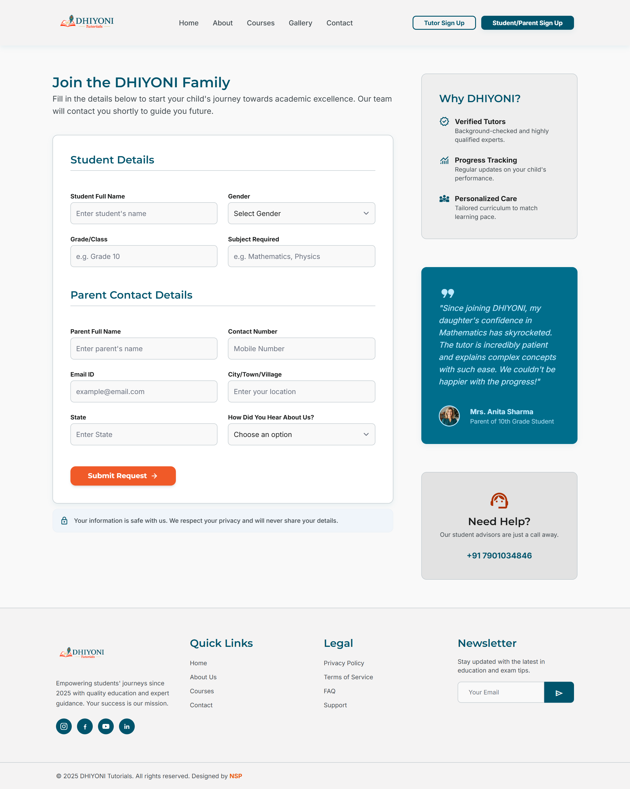
_Figure 8: Student enrollment interface with parent contact validation and trust assurance badges._

---

### 8. 💼 Tutor Recruitment Portal (`/tutor-signup`)

- **Live URL:** [dhiyonitutorials.com/tutor-signup](https://www.dhiyonitutorials.com/tutor-signup)
- **Target Audience:** Educators applying to join DHIYONI's teaching faculty.
- **Key Modules:**
  - **3-Step Application Wizard:**
    1. _Step 1: Personal Details_ (Name, Gender, Email, Contact, Date of Birth, Location).
    2. _Step 2: Academic Expertise_ (Highest Qualification, College, Subject Expertise, Target Boards).
    3. _Step 3: Availability & Logistics_ (Teaching mode, available hours per week, expected hourly remuneration).
  - **CRM Routing:** Submits candidate portfolio directly to the admin portal under the Tutor Applications tab for candidate status screening.

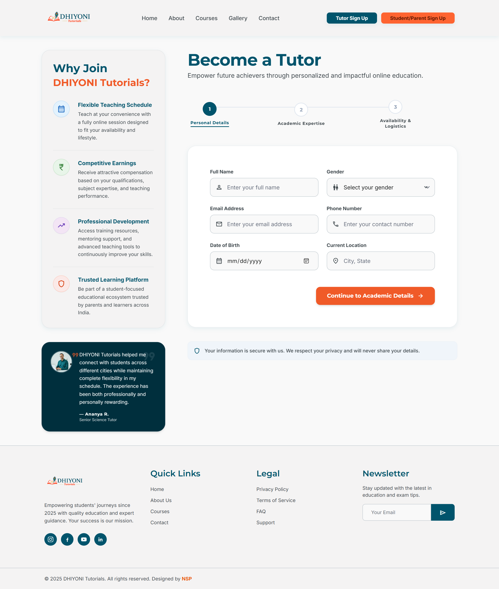
_Figure 9: Multi-step educator onboarding form with structured qualification gathering._

---

### 9. ❓ Frequently Asked Questions (`/faq`)

- **Live URL:** [dhiyonitutorials.com/faq](https://www.dhiyonitutorials.com/faq)
- **Target Audience:** Parents and prospective tutors researching operational policies.
- **Key Modules:**
  - Interactive accordions covering tutor selection, curriculum alignment, online vs. offline classroom modes, and fee structure details.

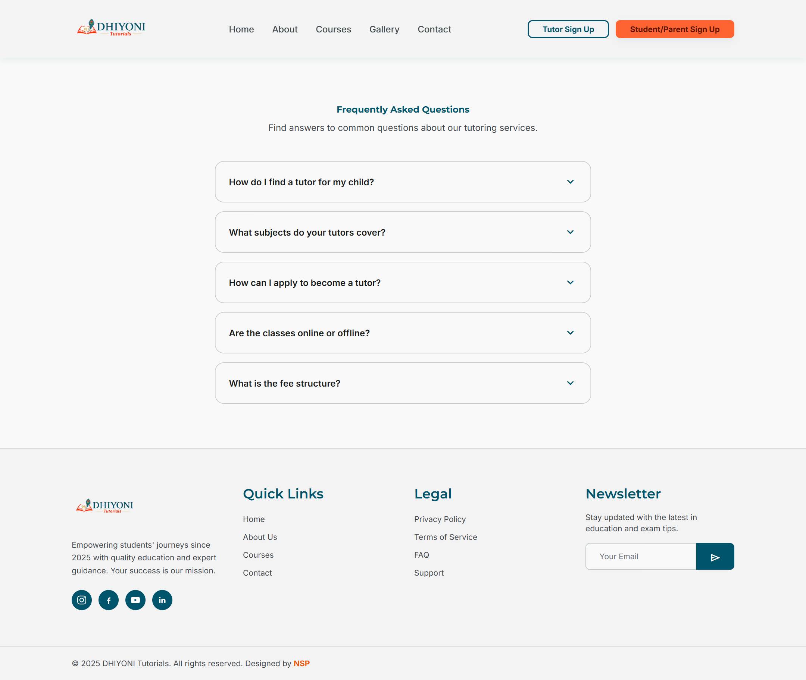
_Figure 10: Frequently Asked Questions page with accordion toggles._

---

## 🛡️ Administrative Portal Deep-Dive (`/admin/*`)

The administrative portal is a secured single-page application (SPA) layout equipped with token-based access control, real-time counters, search filters, status updates, and full database CRUD controllers.

---

### 10. 🔐 Admin Authentication Gateway (`/admin/login`)

- **Live URL:** [dhiyonitutorials.com/admin/login](https://www.dhiyonitutorials.com/admin/login)
- **Security:**
  - Verifies credentials against MongoDB via `/api/auth/login`.
  - Generates signed JWT Bearer Token stored in `localStorage` under `dhiyoni_admin_token`.
  - Password visibility toggle and failure alerts for invalid login attempts.

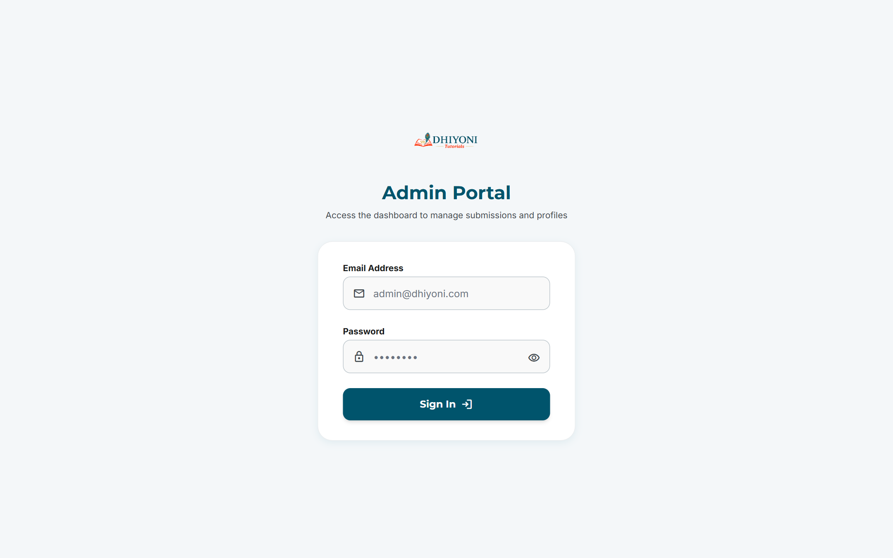
_Figure 11: Secured administrator authentication gateway._

---

### 11. 📊 Executive Dashboard Overview (`/admin?tab=overview`)

- **Key Capabilities:**
  - **Real-Time KPI Cards:** Instant metrics on Parent Signups, Tutor Applications, General Inquiries, and Newsletter Subscribers.
  - **Action Required Badges:** Pulsing badges highlighting pending submissions awaiting review.
  - **Recent Activity Feed:** Unified chronological log of recent leads across all form channels.

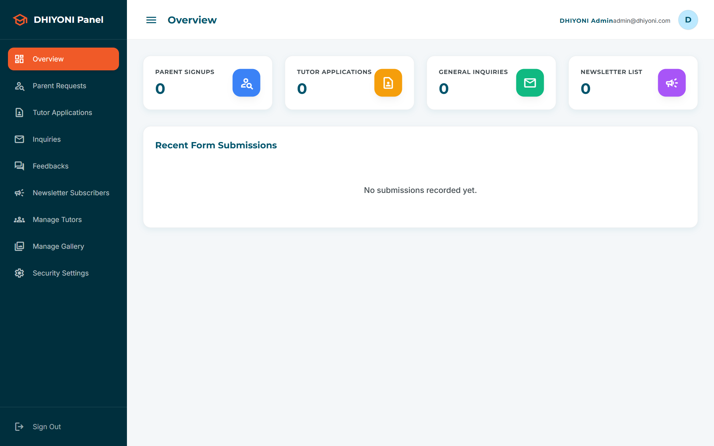
_Figure 12: Executive administrative dashboard displaying overall platform KPIs and pending counters._

---

### 12. 👨‍👩‍👧 Parent Enrollment CRM (`/admin?tab=parentSignups`)

- **Key Capabilities:**
  - Tabular list of student enrollment requests with submission timestamp, student name, grade, subjects, and parent contact details.
  - **Status Lifecycle:** `Pending` ➔ `Contacted` ➔ `Enrolled` ➔ `Archived`.
  - **Actions:** View full modal profile, filter by status or grade, and delete records.

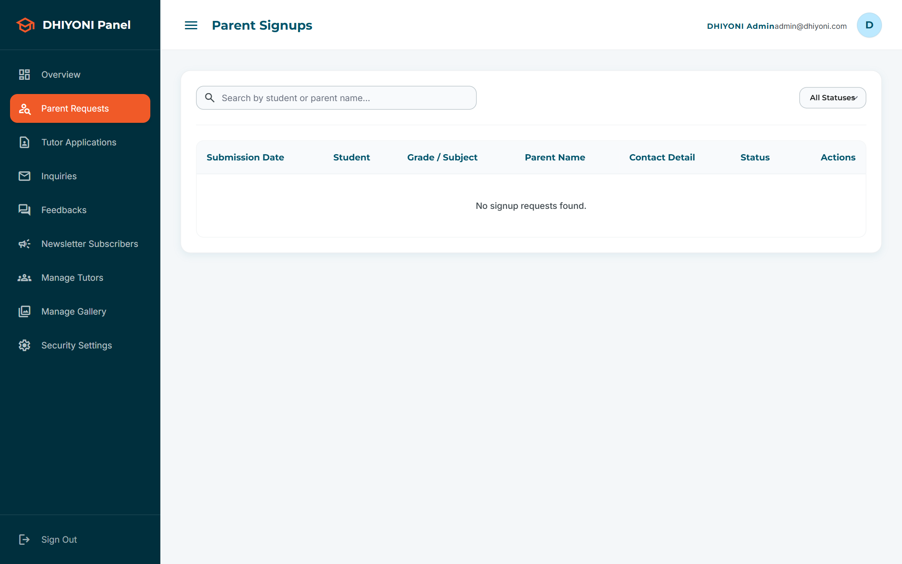
_Figure 13: Parent enrollment CRM module with lifecycle status tagging and search filtering._

---

### 13. 🎓 Tutor Application Reviewer (`/admin?tab=tutorSignups`)

- **Key Capabilities:**
  - Comprehensive view of applicant profiles, educational degrees, subject specialization, location, and teaching experience.
  - **Review Pipeline:** `Pending` ➔ `Interview Scheduled` ➔ `Approved` ➔ `Rejected`.
  - Instant applicant modal showing complete background and contact details for phone/video interviews.

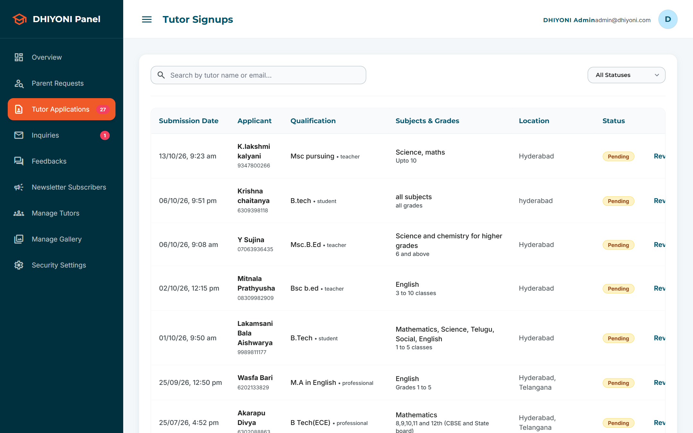
_Figure 14: Tutor recruitment pipeline displaying applicant qualifications, subjects, and review statuses._

---

### 14. 📬 Contact Inquiries Inbox (`/admin?tab=contacts`)

- **Key Capabilities:**
  - Aggregates messages submitted via the Contact Us page.
  - Shows sender name, email, subject category, and message preview.
  - Status toggle (`Pending` / `Resolved`) to ensure zero unaddressed inquiries.

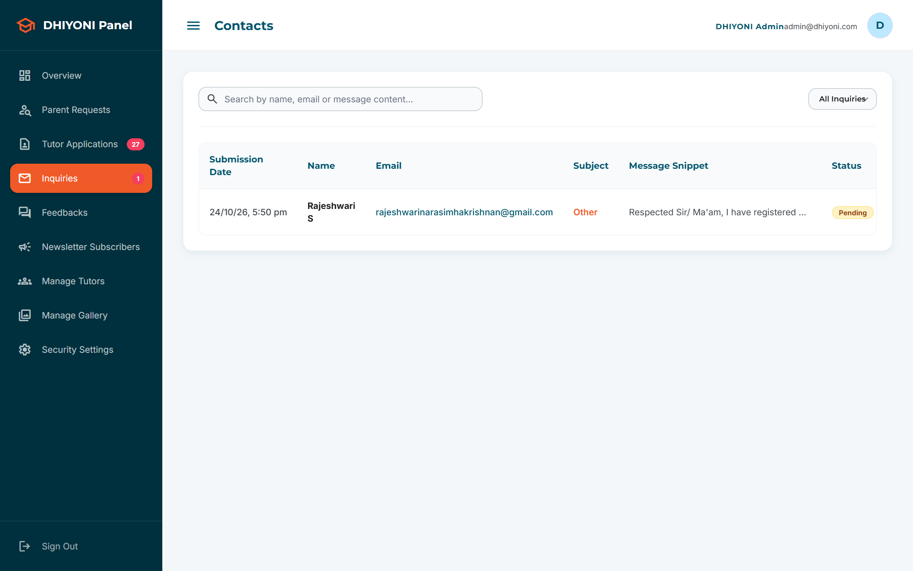
_Figure 15: General inquiries inbox with message snippets and resolution statuses._

---

### 15. ⭐ Feedbacks & Testimonials Moderation (`/admin?tab=feedbacks`)

- **Key Capabilities:**
  - Displays reviews, star ratings, and student comments submitted from the public site.
  - Review moderation to curate authentic testimonials displayed on the homepage.

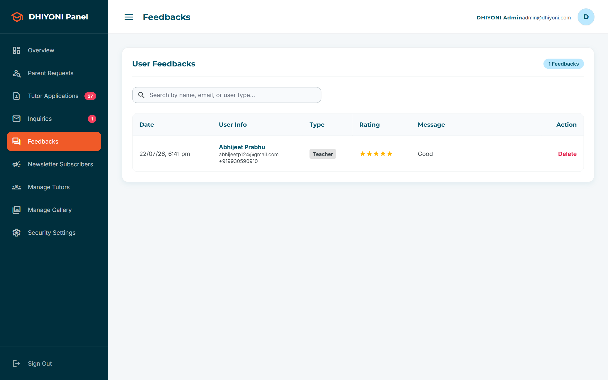
_Figure 16: Feedback and testimonial review module._

---

### 16. 📰 Newsletter Subscriber List (`/admin?tab=newsletters`)

- **Key Capabilities:**
  - Tracks all subscribed email addresses captured via the footer newsletter component.
  - Displays subscription dates with one-click unsubscribe/removal actions.

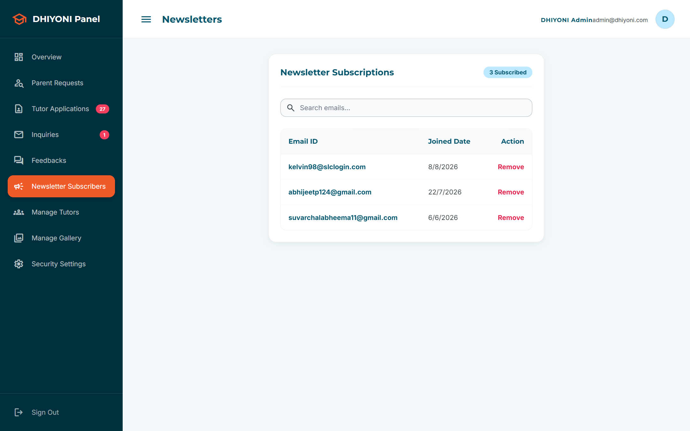
_Figure 17: Newsletter subscriber mailing list management._

---

### 17. 👥 Faculty & Tutors CRUD Manager (`/admin?tab=tutorsCrud`)

- **Key Capabilities:**
  - **Add New Tutor:** Modal form to upload photo URL, name, qualification, subject, experience, rating, and board.
  - **Edit Tutor:** Modify existing educator profiles in real time.
  - **Delete Tutor:** Instantly purge decommissioned educator cards from the live `/tutors` page.

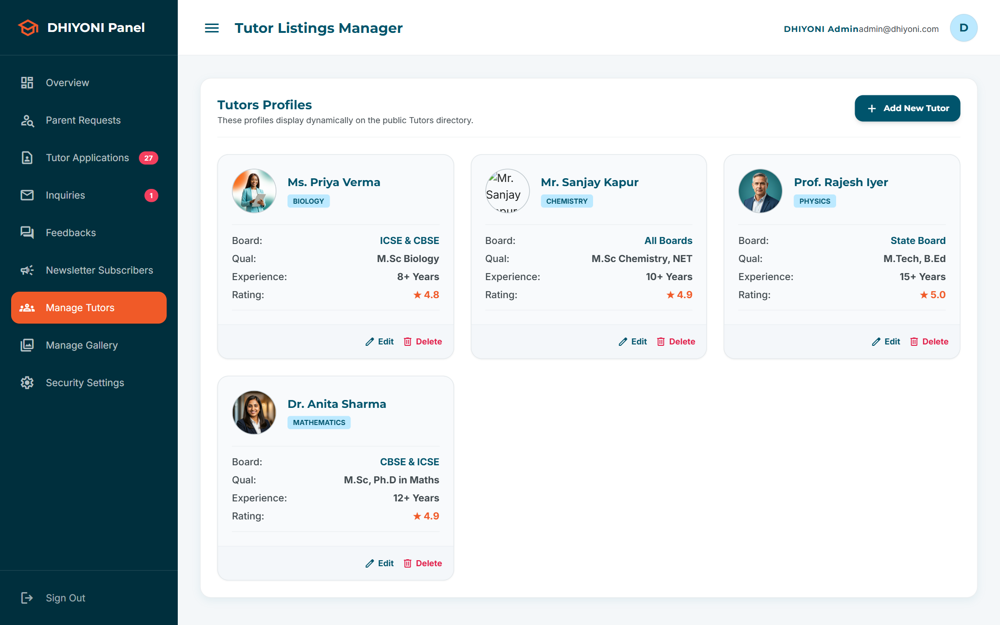
_Figure 18: Live tutor profile manager with Add, Edit, and Delete controls._

---

### 18. 🖼️ Gallery Media Manager (`/admin?tab=manageGallery`)

- **Key Capabilities:**
  - Directly add new image assets to the gallery by providing an image URL, descriptive alt text, and category (Classroom, Events, Workshops, General).
  - Preview current gallery grid and delete obsolete image entries.

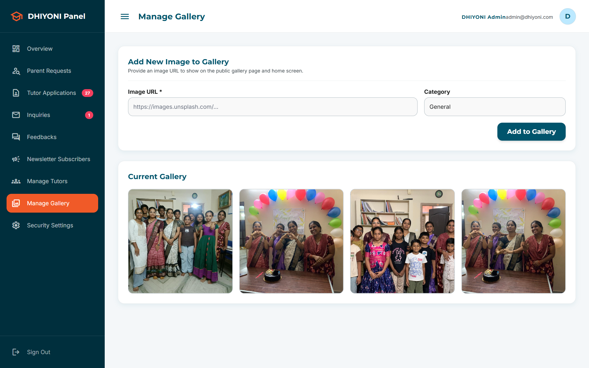
_Figure 19: Gallery management suite for updating public campus and student engagement photos._

---

### 19. 🔒 Security & Profile Settings (`/admin?tab=settings`)

- **Key Capabilities:**
  - Form to update the admin account password.
  - Validates current password via `/api/auth/password` before hashing and committing new credentials to MongoDB.

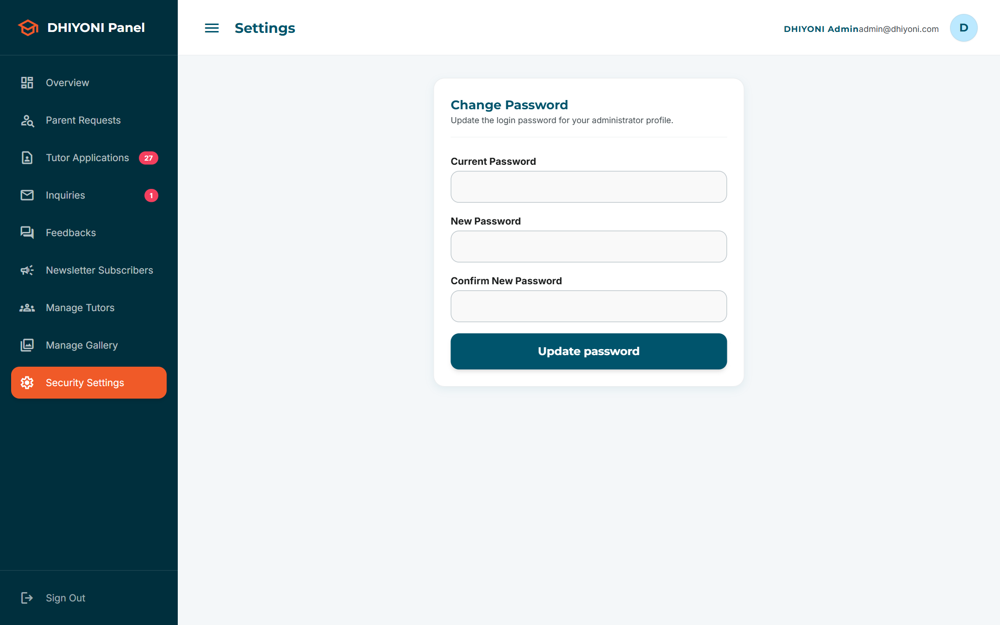
_Figure 20: Security panel enabling administrative password rotation._

---

## 📡 REST API Reference

The backend provides a modular RESTful API architecture:

| Endpoint                  | Method          | Access             | Description                                                     |
| :------------------------ | :-------------- | :----------------- | :-------------------------------------------------------------- |
| `/api/health`             | `GET`           | Public             | System diagnostic check (MongoDB connection & environment)      |
| `/api/auth/login`         | `POST`          | Public             | Authenticates admin credentials and returns JWT                 |
| `/api/auth/profile`       | `GET`           | Protected (JWT)    | Validates active admin session token                            |
| `/api/auth/password`      | `PUT`           | Protected (JWT)    | Updates admin account password                                  |
| `/api/parent-signups`     | `GET`, `POST`   | Protected / Public | Fetch all parent requests or submit new parent registration     |
| `/api/parent-signups/:id` | `PUT`, `DELETE` | Protected (JWT)    | Update lead status (`Enrolled`, `Contacted`) or delete lead     |
| `/api/tutor-signups`      | `GET`, `POST`   | Protected / Public | Fetch candidate applications or submit new educator application |
| `/api/tutor-signups/:id`  | `PUT`, `DELETE` | Protected (JWT)    | Update applicant status (`Interview Scheduled`, etc.) or delete |
| `/api/contacts`           | `GET`, `POST`   | Protected / Public | Fetch contact inquiries or submit new contact form              |
| `/api/contacts/:id`       | `PUT`, `DELETE` | Protected (JWT)    | Update inquiry resolution status or delete inquiry              |
| `/api/tutors`             | `GET`, `POST`   | Public / Protected | Retrieve public tutor directory or add new tutor listing        |
| `/api/tutors/:id`         | `PUT`, `DELETE` | Protected (JWT)    | Update or remove faculty profile                                |
| `/api/gallery`            | `GET`, `POST`   | Public / Protected | Fetch gallery images or publish new image asset                 |
| `/api/gallery/:id`        | `DELETE`        | Protected (JWT)    | Remove image from gallery                                       |
| `/api/newsletters`        | `GET`, `POST`   | Protected / Public | List newsletter subscribers or submit new subscription          |
| `/api/newsletters/:id`    | `DELETE`        | Protected (JWT)    | Remove subscriber                                               |
| `/api/feedback`           | `GET`, `POST`   | Protected / Public | Fetch approved feedback or submit new student feedback          |

---

## 🚀 Local Development Setup

### 1. Prerequisites

- **Node.js:** v18.0.0 or higher (v24 recommended)
- **npm:** v9.0.0 or higher
- **MongoDB:** Active MongoDB Atlas URI or local MongoDB instance

### 2. Environment Configuration

Create a `.env` file in the `backend/` directory:

```env
PORT=5000
MONGODB_URI=your_mongodb_connection_string
JWT_SECRET=your_jwt_secret_key
NODE_ENV=development
EMAIL_HOST=smtp.gmail.com
EMAIL_PORT=587
EMAIL_USER=your_email@gmail.com
EMAIL_PASS=your_app_password
EMAIL_FROM=your_email@gmail.com
ADMIN_EMAIL=admin@dhiyoni.com
ADMIN_PASSWORD=DhiyoniAdmin2026!
EMAIL_TO=your_notifications_email@gmail.com
```

### 3. Install All Dependencies

Run from the root project folder:

```bash
npm run install:all
```

### 4. Run Locally in Concurrent Mode

Start both frontend (Vite) and backend (Express) concurrently:

```bash
npm run dev
```

- **Frontend:** `http://localhost:5173`
- **Backend API:** `http://localhost:5000`

---

## 🌐 Production Deployment

The project is architected for zero-maintenance deployment on **Vercel**:

- **Frontend:** Static Single-Page App built with Vite (`dist/`) and routed via `frontend/vercel.json`.
- **Backend:** Hosted as a Vercel Serverless Function via `backend/vercel.json` pointing to `src/server.js`.
- **Production Domain:** `https://www.dhiyonitutorials.com`

---

## 👨‍💻 Author & Credits

- **Platform Concept & Operations:** DHIYONI Tutorials Team
- **Engineering & Architecture:** NSP ([Portfolio](https://sriparthu.vercel.app/))
- **Live Inquiries:** [+91 79010 34846](https://wa.me/917901034846) | `dhiyonitutorials@gmail.com`
- **Headquarters:** Sigma Sarovar, Bandam kommu, Ameenpur Road, Hyderabad, India.
